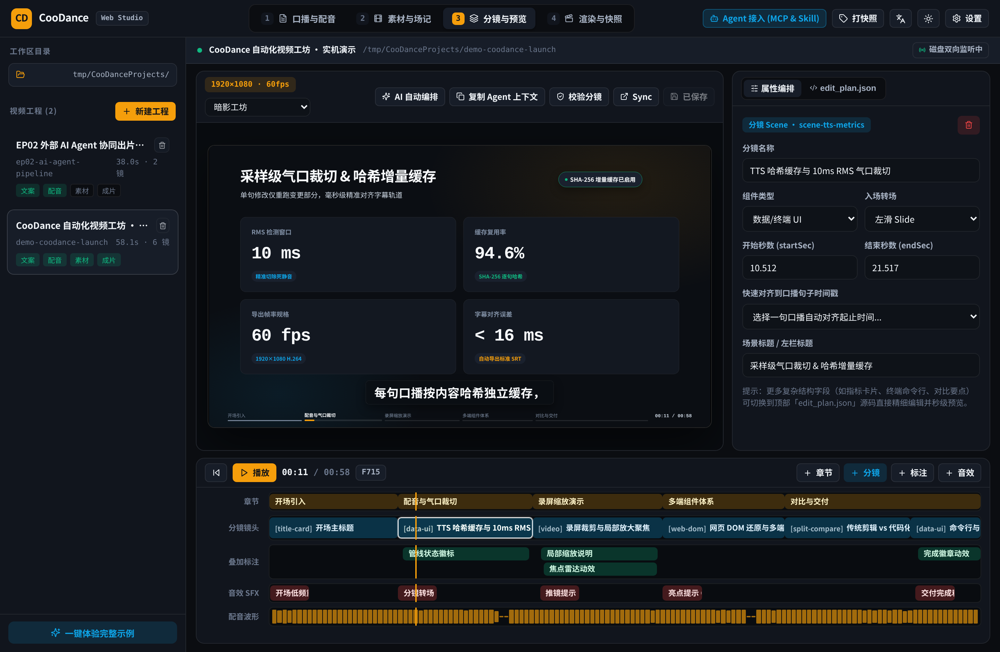
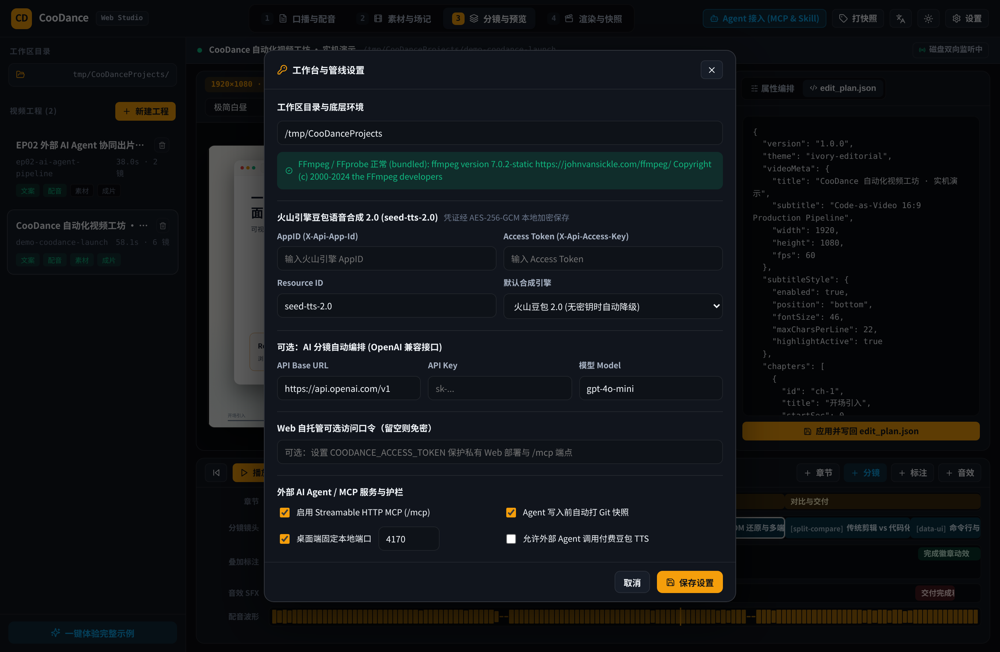
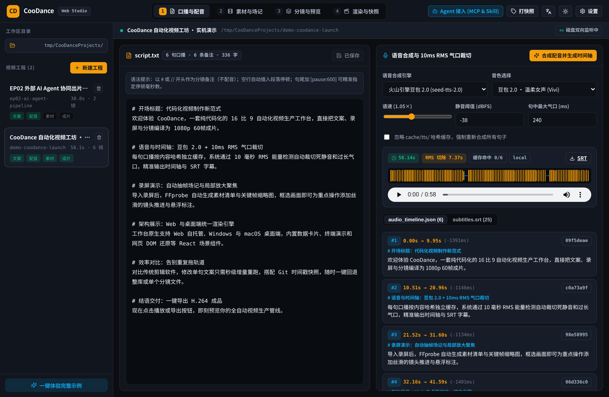
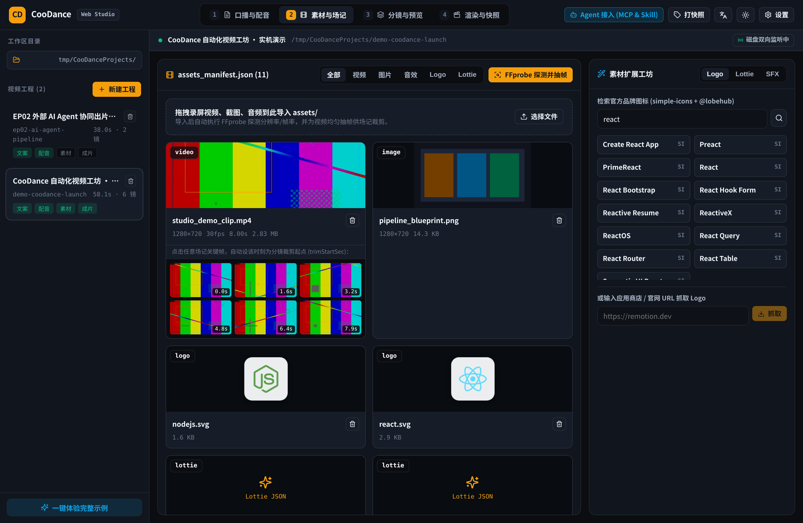
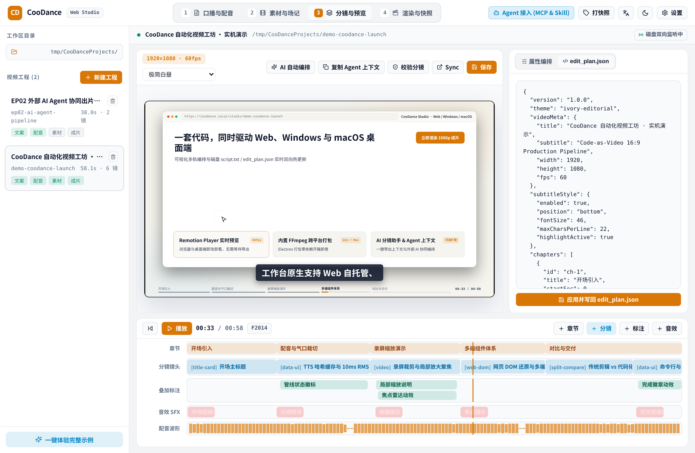
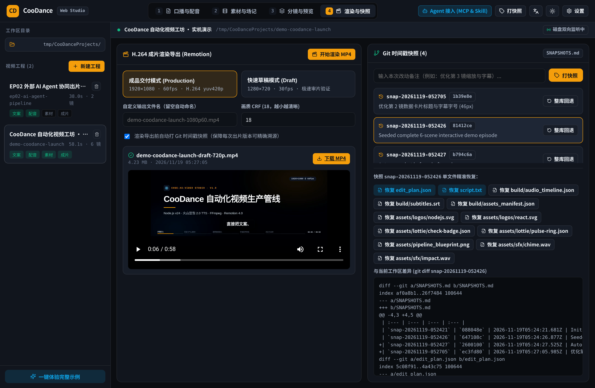
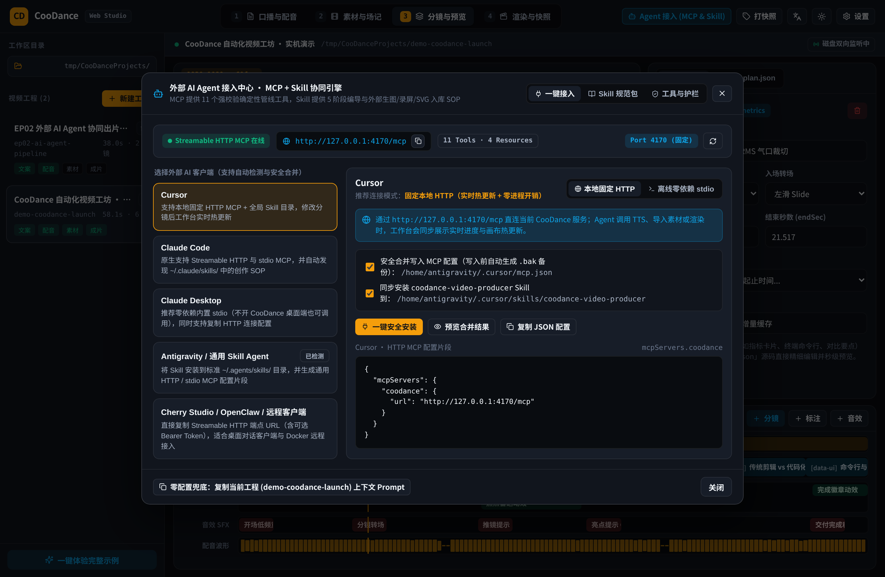

# CooDance Studio — Code-as-Video 16:9 自动化视频工作台

[](https://nodejs.org/)
[](https://www.remotion.dev/)
[](https://react.dev/)
[](https://www.electronjs.org/)
[](#外部-ai-agent-接入mcp--skill-协同架构)
[](LICENSE)

**CooDance** 是一套面向 **Web 自托管、Windows 桌面、macOS 桌面与 CLI / AI Agent** 的纯代码化（Code-as-Video）16:9 自动化视频生产工作台。它在提供现代化多轨可视化编排与 `@remotion/player` 60fps 实时预览的同时，磁盘严格保持标准 `script.txt` / `assets/` / `edit_plan.json` / `build/` / `out/` 文件结构，实现与命令行脚本和外部 AI 编程助手的 100% 双向热更新兼容。



> **快速导航**：[核心亮点](#核心特性亮点) · [快速开始](#快速开始) · [应用使用说明](#应用使用说明) · [外部 AI Agent 接入](#外部-ai-agent-接入mcp--skill-协同架构) · [标准工程目录](#标准工程磁盘目录结构) · [环境变量与配置](#环境变量与配置说明) · [CLI 命令清单](#命令行cli管线命令清单) · [核心架构](#核心架构monorepo)

---

## 核心特性亮点

- **四步全链路可视化工作台**：围绕 **「1 口播与配音 → 2 素材与场记 → 3 分镜与预览 → 4 渲染与快照」** 构建，所有界面改动即时写回磁盘，外部编辑器修改文件也通过 Chokidar 实时热重载回画布。
- **增量配音与 10ms RMS 气口裁切**：支持 **火山引擎豆包 2.0（`seed-tts-2.0`）**、**免费 Edge-TTS** 与 **本地离线演示语音**，逐句计算 SHA-256 哈希存入 `cache/tts/` 实现秒级增量重跑，自动裁切死静音与过长气口并输出毫秒级 `audio_timeline.json` 与标准 `subtitles.srt`。
- **FFprobe 场记抽帧与素材工坊**：拖拽导入录屏、图片或音频自动探测分辨率与帧率，并为视频均匀抽帧，点击缩略图即可直设为分镜裁剪起点（`trimStartSec`）；内置品牌 Logo、Lottie 矢量动效与纯 DSP 无版权音效工坊。
- **6 类声明式分镜 + 7 类叠加层 + 3 套主题**：内置标题卡、录屏局部推镜、图片 Ken Burns 运镜、分屏对比、数据/终端/管线/柱状图 UI 与网页 DOM 还原组件，支持暗/亮双色工作台与中/英双语切换。
- **每工程独立 Git 时间戳快照**：每次关键改动或渲染导出前自动打标并写入 `SNAPSHOTS.md`，内置可视化 `git diff` 对比，支持整库回退或单文件（如 `edit_plan.json`、`script.txt`）精准恢复。
- **MCP + Skill 外部 AI Agent 协同**：内置 11 个强校验 MCP 工具与 4 个渐进式 Resources，以及 5 阶段编导 Skill 规范包，支持一键安全接入 Cursor、Claude Code、Claude Desktop、Antigravity 与 Cherry Studio。

---

## 快速开始

### 环境要求

- **Node.js** `>= 22.0.0`（推荐 Node.js 24 LTS）
- **Git**（用于每工程独立快照与版本回退）
- **FFmpeg / FFprobe**：工作台优先自动使用内置二进制，亦支持系统已安装版本或通过环境变量自定义路径
- **Chromium / Chrome**：用于 Remotion 无头渲染导出 H.264 MP4（Docker 镜像已预装 Chromium 与 Noto CJK 中文字体）

### 方式 1：本地安装与启动 Web 工作台

```bash
# 1. 安装依赖并构建 Monorepo 全部包
npm install
npm run build

# 2. 启动 CooDance Web 工作台与 MCP 引擎
npm start
```

启动完成后访问：
- **Web 工作台**：`http://127.0.0.1:4170`
- **Streamable HTTP MCP 端点**：`http://127.0.0.1:4170/mcp`

> 开发联调可使用 `npm run dev:server` 与 `npm run dev:web` 分别热启动后端与 Vite 前端。

### 方式 2：Docker Compose 一键私有自托管

```bash
docker compose up -d --build
```

默认将容器内工作区与配置分别持久化挂载到宿主机的 `./workspace` 与 `./config` 目录，并映射端口 `4170`。如需公网或局域网访问保护，可在 `docker-compose.yml` 中取消注释 `COODANCE_ACCESS_TOKEN` 环境变量，工作台网页与 `/mcp` 端点将同步启用口令认证。

### 方式 3：运行或打包 Windows / macOS / Linux 桌面端

```bash
# 本地启动 Electron 桌面端
npm run desktop:dev

# 打包 Windows 安装包 (.exe NSIS + Portable)
npm run desktop:build:win

# 打包 macOS 安装包 (arm64 + x64 .dmg)
npm run desktop:build:mac

# 打包 Linux 安装包
npm run desktop:build:linux
```

---

## 应用使用说明

### 零门槛上手：一键体验示例与基础设置

1. **一键体验完整示例**：首次打开 CooDance，点击左侧边栏底部的 **「一键体验完整示例」** 按钮，系统会在工作区自动创建 `demo-coodance-launch` 工程，生成包含 6 个场景、合成配音、模拟录屏、Logo、Lottie 动效、DSP 音效与完整分镜的实机案例，直接可播放预览与渲染导出。
2. **新建自己的视频工程**：点击左侧边栏 **「+ 新建工程」**，填写视频标题、目录标识（Slug，用于磁盘文件夹命名）以及初始 16:9 视觉主题：
   - `obsidian-studio`（暗影工坊，深色科技发布风）
   - `ivory-editorial`（极简白昼，浅色杂志解说风）
   - `cyber-emerald`（赛博翠光，高对比终端/AI 演示风）
3. **配置引擎与环境自检**：点击右上角 **「设置」** 图标打开配置弹窗：
   - **工作区目录与底层环境**：修改工程存放目录（默认 `~/CooDanceProjects`），实时查看 FFmpeg / FFprobe 状态自检结果。
   - **火山引擎豆包语音合成 2.0**：填入 `AppID` 与 `Access Token`（本地使用 **AES-256-GCM** 加密存储）；不填密钥时可直接切换免费 **Edge-TTS** 或 **本地离线演示语音** 完整跑通全流程。
   - **可选 AI 分镜编排**：填入任意 OpenAI 兼容接口（`API Base URL`、`API Key`、`Model`），即可在分镜页一键触发 AI 自动编排。
   - **安全口令与 MCP 护栏**：可设置自托管 Web 访问口令，以及桌面端固定端口、Agent 写前自动快照与付费豆包 TTS 防误扣费开关。



---

### 阶段 1：口播与配音（`1 口播与配音`）

切换到顶部导航 **「1 口播与配音」**，在左侧编写或修改 `script.txt`，在右侧配置合成参数并生成毫秒级语音时间轴。



#### `script.txt` 口播脚本语法

```text
# 开场标题：引出视频主题（以 # 或 // 开头作为分镜视觉备注，不参与配音）
欢迎来到 CooDance 代码化视频工作台，只需写好文案即可编译为 1080p 60 帧成片。

# 核心演示：空行自动插入段落停顿（默认 560ms），相邻句间自动插入短停顿（默认 220ms）
每句口播按内容哈希独立缓存，修改单句时仅增量重跑变更句子。[pause:700]
```

- 按 `Ctrl + S`（macOS 为 `Cmd + S`）或点击 **「保存」** 写回 `script.txt`。
- 句尾添加 `[pause:600]` 可精确覆写该句结束后的停顿毫秒数。

#### 语音合成与 10ms RMS 气口裁切

1. 选择语音合成引擎（**火山豆包 2.0** / **免费 Edge-TTS** / **本地演示语音**）与音色，调整语速（`0.75×–1.50×`）、静音阈值（默认 `-38 dBFS`）及句中最大允许气口（默认 `240 ms`）。
2. 点击右上角 **「合成配音并生成时间轴」**：
   - 逐句按文本与音色计算 SHA-256 哈希，命中 `cache/tts/` 直接复用（勾选「忽略哈希缓存」可强制全部重跑）。
   - 自动切除句首尾死静音与句中过长气口，生成 `build/voiceover.mp3`、`build/audio_timeline.json` 与 `build/subtitles.srt`。
3. 合成完成后可在右侧直接试听配音波形、切换查看逐句时间戳（含每句切除的气口毫秒数与缓存命中状态）或点击 **「SRT」** 下载字幕文件。

---

### 阶段 2：素材与场记（`2 素材与场记`）

切换到 **「2 素材与场记」** 管理当前工程 `assets/` 目录下的全部媒体，并借助右侧工坊快速补充视觉与音效元素。



1. **拖拽导入与 FFprobe 自动探测**：将录屏视频（`.mp4`/`.mov`/`.webm`）、截图、图片或音频拖入上传条（或点击「选择文件」），系统会自动探测宽高、帧率与时长，更新 `build/assets_manifest.json`，并为每个视频均匀抽取 6 张场记关键帧。
2. **场记一键绑定裁剪起点**：在任意视频卡片下方点击对应的关键帧缩略图（如 `1.6s`、`3.2s`），工作台会自动跳转到分镜页并将该时间点写入视频分镜的 `trimStartSec`。
3. **右侧素材扩展工坊**：
   - **Logo**：输入关键词（如 `react`、`docker`、`openai`、`github`）从 `simple-icons` 与 `@lobehub` 检索官方矢量图标，或粘贴任意官网 / 应用商店 URL 自动抓取保存至 `assets/logos/`。
   - **Lottie**：一键加入内置 Lottie v5 矢量动效（`pulse-ring`、`sparkle-burst`、`check-badge`、`audio-bars`、`rocket-launch`、`fire-glow`）或拉取远程 `.json` / Telegram `.tgs` 至 `assets/lottie/`。
   - **SFX**：纯 DSP 算法离线生成 10 款无版权转场与交互音效（`whoosh`、`pop`、`click`、`chime`、`swoosh`、`typing`、`riser`、`success`、`notification`、`impact`）至 `assets/sfx/`，支持即点试听。

---

### 阶段 3：分镜与预览（`3 分镜与预览`）

切换到 **「3 分镜与预览」**，在 16:9 实时画布、五轨同步时间轴与双向属性/源码编辑器中完成全部视觉编排。

#### 可视化交互与多轨时间轴

- **16:9 实时预览**：顶部工具栏显示画布规格（`1920×1080 · 60fps`），可下拉实时切换 3 套视觉主题；点击画布或底部 **「播放」** 按钮即可逐帧预览动画、章节进度条与高亮字幕。
- **五轨同步时间轴**：底部依次排列 **章节（Chapters）**、**分镜镜头（Scenes）**、**叠加标注（Overlays）**、**音效（SFX）** 与 **配音波形（Voice）** 五条同步轨道。点击轨道空白处可快速定位播放头，点击任意区块即在右侧打开其属性表单，点击工具栏 `+ 章节 / + 分镜 / + 标注 / + 音效` 可在当前播放头处插入新元素。
- **录屏画布「框选局部缩放」**：选中类型为 `video` 的录屏分镜后，点击画布上方 **「框选局部缩放」**，直接在 16:9 画面上按住鼠标左键拖拽目标区域，松手后自动写入归一化 `zoomRegion` 坐标并实时预览丝滑推镜效果。
- **AI 编排、强校验与 Remotion Studio 联动**：
  - **AI 自动编排**：依据当前 `audio_timeline.json` 与 `assets_manifest.json` 自动生成对齐口播时间戳的完整分镜。
  - **校验分镜**：执行 Zod Schema + 时间轴无断层/重叠 + 素材存在性 + 推镜坐标边界强校验，提前拦截脏配置。
  - **Sync**：将当前工程同步至 `packages/remotion`，随后可运行 `npm run studio` 在 Remotion 官方 Studio 中做高级逐帧调试。

#### 内置 6 类声明式分镜组件与 7 类叠加层

| 分镜组件 (`scene.type`) | 适用场景 | 叠加标注层 (`overlay.type`) | 典型用途 |
| :--- | :--- | :--- | :--- |
| `title-card` | 开场主标题、章节转场卡、片尾行动号召 | `callout` | 带标题与副文本的重点说明卡片 |
| `video` | 录屏片段裁剪、倍速、设备外框与 `zoomRegion` 局部推镜 | `arrow` | 8 方向指示箭头，精准指向 UI 细节 |
| `image` | 截图、SVG 架构图、AI 插画 + Ken Burns 运镜 | `highlight-box` | 发光高亮聚焦框，框出关键区域 |
| `split-compare` | 左右分屏 Before/After 或方案优劣要点对比 | `badge` | 顶部/角落悬浮状态徽章标签 |
| `data-ui` | 零素材程序化动效：`metrics` 指标卡 / `terminal` 终端 / `pipeline` 流程图 / `bar-chart` 柱状图 | `lottie` | 雷达焦点环、完成对勾等矢量动效 |
| `web-dom` | 还原浏览器窗口、功能高亮卡片与自动移动鼠标光效 | `logo` / `text-card` | 悬浮品牌矢量 Logo / 金句强调卡 |

#### 暗/亮双色主题与 `edit_plan.json` 源码双向编辑

点击顶部栏太阳/月亮图标即可在 **暗色工坊** 与 **浅色极简** 界面间自由切换（旁边的语言按钮支持中/英双语切换）；点击右侧面板顶部 **`edit_plan.json`** 标签可随时切入完整 JSON 源码模式，手动精调任意复杂字段并点击 **「应用并写回 edit_plan.json」** 即刻生效。



---

### 阶段 4：渲染导出与 Git 时间戳快照（`4 渲染与快照`）

切换到 **「4 渲染与快照」**，完成最终 H.264 MP4 成片导出与全生命周期版本管理。



#### H.264 成片渲染导出

1. 选择渲染预设：
   - **成品交付模式（Production）**：`1920×1080 · 60fps · H.264 yuv420p`（默认 CRF `18`）
   - **快速草稿模式（Draft）**：`1280×720 · 30fps`（默认 CRF `24`，适合快速审片迭代）
2. 可选填写自定义输出文件名与 CRF 画质值（数值越小画质越清晰），建议保持勾选 **「渲染导出前自动打 Git 时间戳快照」**。
3. 点击 **「开始渲染 MP4」**，顶部进度条与下方控制台会通过 WebSocket 实时推送逐帧渲染进度。导出完成后可直接在左侧播放器内回放验收、点击 **「下载 MP4」**（桌面端支持点击 **「定位文件」** 直接在 Finder / 资源管理器中打开 `out/` 目录）。

#### Git 时间戳快照与单文件精准回退

- **随时存档**：点击工作台顶部栏 **「打快照」**，或在右侧输入改动备注后点击 **「打快照」**，自动创建 `snap-YYYYMMDD-HHMMSS` Git 标签并追加审计记录到 `SNAPSHOTS.md`。
- **可视化 Diff 与精准回退**：点击右侧列表中的任意历史快照，下方会立即展示该快照与当前工作区的 **`git diff`**，并提供：
  - **整库回退**：将整个工程一键恢复到该快照状态。
  - **单文件精准恢复**：仅恢复 `edit_plan.json`、`script.txt`、`build/audio_timeline.json` 或某个具体素材文件，保留其他文件的最新修改。
  - 所有回退操作执行前均会自动创建安全备份快照，彻底杜绝误操作丢稿。

---

## 外部 AI Agent 接入（MCP + Skill 协同架构）

CooDance 采用 **「精简聚合 MCP（确定性执行与强校验门禁）+ 富 SOP Skill（5 阶段编导与外部素材生产）」** 协同架构，让外部 AI 编程助手直接接管从写稿、配音、生图/录屏入库、编排校验到异步渲染的全流程。



### 一键接入步骤（推荐）

1. 点击工作台顶部栏 **「Agent 接入 (MCP & Skill)」** 打开接入中心弹窗，顶部状态栏会实时显示 Streamable HTTP MCP 服务在线状态、端点 URL（默认 `http://127.0.0.1:4170/mcp`）以及已暴露的 `11 Tools · 4 Resources`。
2. 在左侧选择你的外部 AI 客户端（支持自动检测 **Cursor**、**Claude Code**、**Claude Desktop**、**Antigravity / 通用 Skill Agent** 与 **Cherry Studio / 远程客户端**）。
3. 按使用习惯切换传输模式：
   - **本地固定 HTTP 模式（`http://127.0.0.1:4170/mcp`）**：CooDance 桌面端或 Web 服务运行时直连，零额外子进程开销；Agent 每次调用 TTS、导入素材或保存分镜时，工作台都会同步展示实时进度与画布热更新；远程 Docker 部署支持通过 `COODANCE_ACCESS_TOKEN` Bearer 鉴权接入。
   - **离线零依赖 stdio 模式（`npm run mcp:stdio` / 桌面端内置 `ELECTRON_RUN_AS_NODE=1`）**：无需先打开 CooDance 窗口即可后台读写工作区，下次打开软件自动同步。
4. 点击 **「预览合并结果」** 检查配置，再点击 **「一键安全安装」**：写入前会自动生成 `.coodance.bak.<timestamp>` 备份并仅合并 `mcpServers.coodance`，同时自动部署 `coodance-video-producer` Skill。
5. 如客户端无全局 Skill 目录，可在 **「Skill 规范包」** 标签页下载 `coodance-video-producer-skill.zip`，或通过弹窗底部的 **「复制当前工程上下文 Prompt」** 实现零配置兜底协作。

### 四大内置安全与成本护栏

1. **`edit_plan.json` 写前强校验门禁**：严格校验 Zod Schema、时间轴无断层/重叠、素材磁盘路径存在性与推镜坐标边界，出错时返回精确字段路径与修复建议。
2. **`coodance_import_asset` 统一外部素材入库**：支持本地路径、URL、Base64 图片、自定义 SVG/Lottie 文本，自动防目录穿越、校验体积并触发 FFprobe 探测。
3. **写前自动 Git 快照**：Agent 覆写 `script.txt` / `edit_plan.json` 或触发渲染前自动打标快照，保障人工精调成果可一键回退。
4. **异步渲染防超时 & TTS 成本开关**：渲染任务以非阻塞 Job 后台执行并轮询进度；默认关闭外部 Agent 触发付费豆包 TTS，可在 **「工具与护栏」** 标签按需开启。

<details>
<summary>展开查看 11 个 MCP 工具与 4 个渐进式 Resources 清单</summary>

| 阶段 | MCP 工具名 | 功能说明 |
| :--- | :--- | :--- |
| 项目管理 | `coodance_manage_project` | 列出工程、查看完整摘要、初始化新工程、生成 6 镜实机示例或删除工程 |
| 口播与配音 | `coodance_update_script` | 写入或更新 `script.txt`（覆写前自动快照） |
| 口播与配音 | `coodance_run_tts` | 逐句合成配音 + 10ms RMS 气口裁切，生成时间轴与 SRT（复用 SHA-256 缓存） |
| 素材工坊 | `coodance_import_asset` | 接收外部 Agent 生成的图片/录屏/SVG/Lottie/URL/Base64 安全入库并探测 |
| 素材工坊 | `coodance_enrich_assets` | 检索并拉取品牌 Logo、Lottie 动效与程序化 DSP 音效 |
| 素材工坊 | `coodance_inspect_assets` | 执行 FFprobe 探测与视频均匀抽帧，刷新 `assets_manifest.json` |
| 分镜门禁 | `coodance_validate_edit_plan` | 演练强校验 `edit_plan.json`，返回精确错误与自愈建议 |
| 分镜门禁 | `coodance_save_edit_plan` | 校验通过后保存 `edit_plan.json`（或触发自动对齐生成），工作台实时热更新 |
| 异步渲染 | `coodance_render_video` | 校验分镜后启动非阻塞 H.264 MP4 渲染任务，立即返回 `jobId` |
| 异步渲染 | `coodance_get_render_status` | 轮询异步渲染进度、阶段日志与输出 MP4 文件路径及大小 |
| 版本回退 | `coodance_manage_snapshot` | 列出、创建、对比 Diff 或回退整库/单文件 Git 快照 |

**内置 MCP Resources**：
- `coodance://workspace/projects` — 当前工作区工程列表与状态摘要
- `coodance://schemas/edit-plan` — `edit_plan.json` 完整 Schema 与校验规范
- `coodance://project/{slug}/context` — 指定工程的口播文案、精确时间轴、素材清单与当前分镜
- `coodance://skill/guide` — `coodance-video-producer` 5 阶段编导指南（`SKILL.md`）

</details>

---

## 标准工程磁盘目录结构

每个视频工程均保存在 `<workspace>/<project-slug>/`（默认工作区为 `~/CooDanceProjects`），并自动初始化独立的本地 Git 仓库：

```text
<workspace>/<project-slug>/
├── script.txt                  # 口播文案与 # / // 分镜视觉备注
├── edit_plan.json              # 声明式分镜、章节、叠加层、音效与主题配置
├── SNAPSHOTS.md                # Git 时间戳快照审计记录表
├── assets/                     # 工程原始与扩展素材目录
│   ├── *.mp4 / *.png / *.svg   # 上传或由 Agent 导入的录屏、截图与插画
│   ├── logos/                  # 品牌矢量 Logo（simple-icons / @lobehub / URL）
│   ├── lottie/                 # Lottie v5 矢量动效 JSON
│   └── sfx/                    # DSP 合成的无版权 WAV 音效
├── cache/
│   └── tts/                    # 逐句 SHA-256 语音合成缓存（增量重跑加速）
├── build/
│   ├── voiceover.mp3           # 经 10ms RMS 气口裁切与拼接的完整配音轨
│   ├── audio_timeline.json     # 逐句起止秒数、波形峰值与字幕时间轴
│   ├── subtitles.srt           # 自动切分导出的标准 SRT 字幕文件
│   ├── assets_manifest.json    # FFprobe 素材元数据与关键帧清单
│   └── thumbs/                 # 视频均匀抽取的场记缩略图
└── out/
    └── *.mp4                   # Remotion 导出的 H.264 成品 / 草稿视频
```

> **双向热更新机制**：后端通过 Chokidar 持续监听工作区目录。无论你在 VS Code、CLI 还是外部 AI Agent 中直接编辑 `script.txt`、`edit_plan.json` 或放入新素材，Web 与桌面工作台都会自动刷新状态与预览画布。

---

## 环境变量与配置说明

所有配置均可在工作台右上角 **「设置」** 面板图形化修改（保存至 `~/.coodance/settings.json`，敏感密钥自动 AES-256-GCM 加密），也支持在部署或容器启动时通过环境变量覆盖：

| 环境变量 | 默认值 | 说明 |
| :--- | :--- | :--- |
| `COODANCE_HOST` | `127.0.0.1` | 服务端监听地址（Docker 部署设为 `0.0.0.0`） |
| `COODANCE_PORT` | `4170` | Web 工作台与 Streamable HTTP MCP 监听端口 |
| `COODANCE_WORKSPACE` | `~/CooDanceProjects` | 视频工程工作区根目录 |
| `COODANCE_CONFIG_DIR` | `~/.coodance` | 全局设置文件 `settings.json` 存储目录 |
| `COODANCE_ACCESS_TOKEN` | *(空，免密)* | 自托管访问口令，启用后保护 Web 工作台 API 与 `/mcp` Bearer 鉴权 |
| `COODANCE_MCP_ENABLED` | `1` | 设为 `0` 可关闭 Streamable HTTP `/mcp` 端点 |
| `VOLC_TTS_APP_ID` | *(空)* | 火山引擎豆包 2.0 TTS `AppID` |
| `VOLC_TTS_ACCESS_TOKEN` | *(空)* | 火山引擎豆包 2.0 TTS `Access Token` |
| `VOLC_TTS_RESOURCE_ID` | `seed-tts-2.0` | 火山引擎豆包语音合成资源 ID |
| `VOLC_TTS_VOICE` | `zh_female_vv_uranus_bigtts` | 豆包 TTS 默认音色 |
| `OPENAI_API_KEY` | *(空)* | 可选：AI 分镜自动编排使用的 OpenAI 兼容接口密钥 |
| `OPENAI_BASE_URL` | `https://api.openai.com/v1` | 可选：OpenAI 兼容接口 Base URL |
| `OPENAI_MODEL` | `gpt-4o-mini` | 可选：AI 分镜编排模型名称 |
| `REMOTION_BROWSER_EXECUTABLE` | *(自动探测)* | Remotion 渲染使用的 Chromium / Chrome 可执行文件路径 |
| `FFMPEG_PATH` / `FFPROBE_PATH` | *(自动探测)* | 自定义 FFmpeg / FFprobe 二进制路径 |

---

## 命令行（CLI）管线命令清单

所有命令均可与图形工作台和 MCP 混用，磁盘改动会实时热重载到界面中：

```bash
# 1. 初始化工程（支持 --demo 一键生成完整 6 镜实机示例）
npm run init-project -- my-video --title "我的自动化视频"
npm run init-project -- demo-coodance-launch --demo

# 2. 逐句 TTS 合成（火山豆包 2.0 / Edge-TTS / 本地离线）、SHA-256 缓存与 10ms RMS 气口裁切
npm run tts -- my-video --provider doubao --speed 1.05
npm run tts -- my-video --provider edge --voice zh-CN-XiaoxiaoNeural

# 3. FFprobe 素材探测与均匀抽帧场记
npm run inspect-assets -- my-video --thumbs 6

# 4. 素材扩展工具（品牌 Logo、Lottie 矢量动效、程序化 SFX 音效）
npm run fetch-logo -- my-video react
npm run fetch-tg-emoji -- my-video pulse-ring
npm run generate-sfx -- my-video whoosh,pop,chime,success

# 5. 强校验 edit_plan.json（Schema + 时间轴连续性 + 素材存在性）
npm run validate-plan -- my-video

# 6. 启动本地 stdio MCP 服务（供外部 AI 客户端接入）
npm run mcp:stdio

# 7. 同步工程到 Remotion Studio 实时逐帧调试
npm run sync -- my-video
npm run studio

# 8. 渲染导出 H.264 MP4（production: 1920x1080@60fps / draft: 1280x720@30fps）
npm run render-project -- my-video --preset production
npm run render-project -- my-video --preset draft

# 9. Git 时间戳快照与整工程 / 单文件精准回退
npm run snapshot -- my-video "完成第3镜缩放调整"
npm run snapshot -- my-video --list
npm run snapshot -- my-video --restore snap-20261118-183000 --file edit_plan.json
```

---

## 核心架构（Monorepo）

| 包 / 目录 | 说明 |
| :--- | :--- |
| `packages/core` | 纯 Node.js + TypeScript 5.8 核心管线引擎（火山豆包 2.0 / Edge / 离线 TTS + SHA-256 哈希缓存 + 10ms RMS 气口裁切、FFprobe 扫描与抽帧、Logo/Lottie/SFX 素材工坊、外部素材统一入库 `importAsset`、Zod + 时间轴/素材强校验门禁 `editPlanValidator`、异步渲染任务管理、Git 快照与回退、一键 Agent 客户端安装器） |
| `packages/mcp` | 双传输 MCP 服务端（本地零依赖 `stdio` + Express 挂载 Streamable HTTP `/mcp`），提供 11 个高内聚强校验管线工具与 4 个渐进式 MCP Resources |
| `skills/coodance-video-producer` | 面向外部 AI Agent 的 5 阶段 Code-as-Video 编导创作 Skill（`SKILL.md` + 渐进参考文档，涵盖口播写作、外部生图/录屏/SVG 生产入库、6 类分镜审美节奏与 CLI 降级方案） |
| `packages/remotion` | React 19 + Remotion `4.0.414` 16:9 视频合成组件库（标题卡、录屏裁剪与局部推镜、图片运镜、分屏对比、数据/终端/管线 UI、网页 DOM 还原演示、Lottie/Logo/Callout 标注层、章节进度条、动态字幕层，内置 3 套视觉主题） |
| `apps/server` | Express 5 + WebSocket 引擎（Range 媒体流、多文件上传、Streamable HTTP `/mcp` 端点、Chokidar 磁盘双向热监听、可选 Web 访问口令） |
| `apps/web` | 统一 React 19 + Vite 暗/亮双色创作工作台（内置「Agent 接入中心」一键安装弹窗与 Skill 压缩包导出） |
| `apps/desktop` | Electron 桌面外壳 + `electron-builder` 打包配置（Windows `.exe` NSIS/Portable、macOS arm64+x64 `.dmg`，支持可选固定本地 MCP 端口 `4170` 与 `ELECTRON_RUN_AS_NODE=1` 零依赖离线 `stdio` MCP） |
| `scripts/*.mjs` | 完整保留 10 个命令行脚本入口（含 `validate-edit-plan.mjs`），与工作台和 MCP 共享 `@coodance/core` |

---

## 开源协议

本项目基于 [GNU Affero General Public License v3.0 (AGPL-3.0)](LICENSE) 协议开源。
